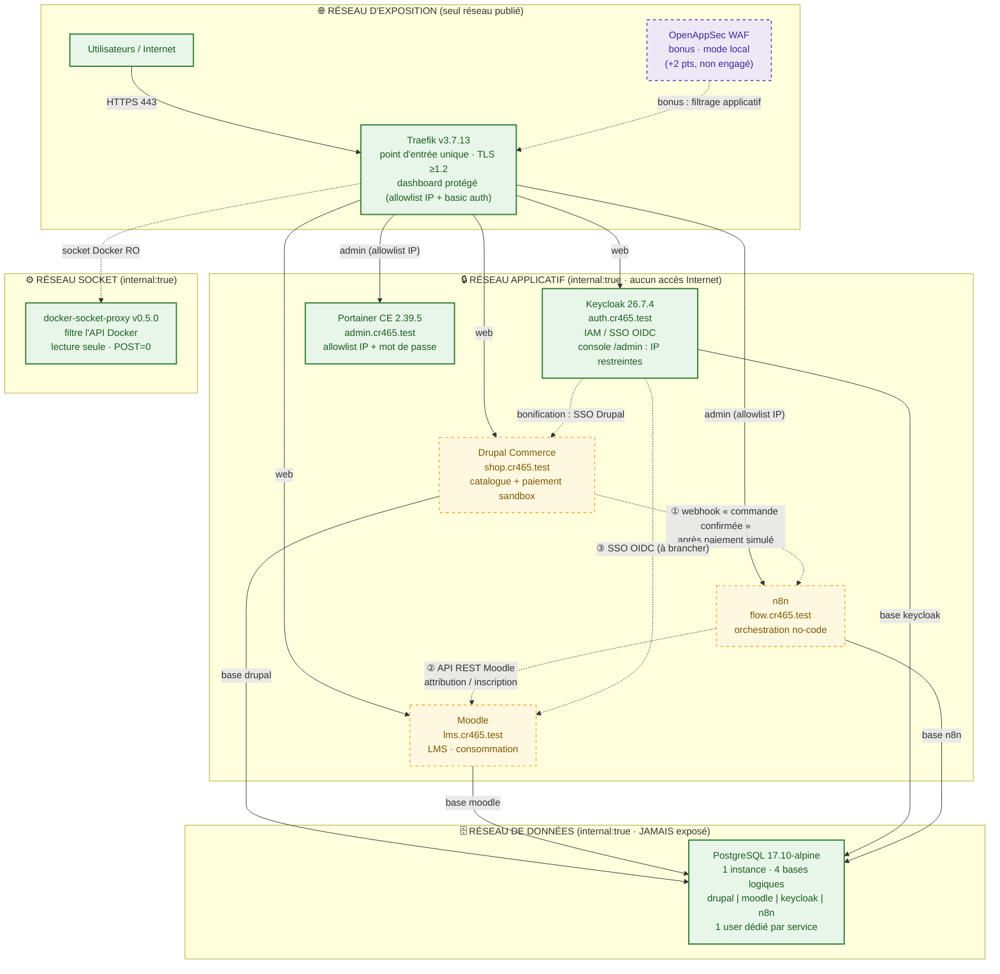
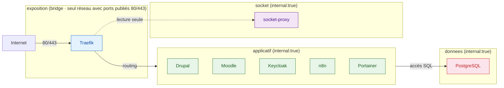
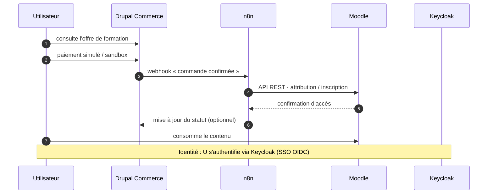

# SCHÉMA D'ARCHITECTURE CONSOLIDÉ — CR465 (fusion, aligné sur le réel)

> Fusion du schéma de l'équipe (flux, sous-domaines, WAF) et du socle réel
> (`cr465.test`, segmentation 4 réseaux, bases logiques PostgreSQL).
> **Trait plein = déployé/vérifié · Pointillé = à construire ou bonus.**
> Conforme à la grille : zones de confiance, flux justifiés, exposition minimale.

---

## 2. Segmentation réseau — le critère /3 explicite

**Flux volontairement INTERDITS (à citer à la correction) :**
- Internet → PostgreSQL (aucun port publié)
- Traefik → PostgreSQL (le proxy ne voit jamais la base)
- Tout service → Internet (réseaux `internal:true`)
- Traefik → socket Docker brut (passage obligé par le filtre RO)

---

## 3. Flux métier attendu (critère Intégration /3)

---

## Points gagnés par cette version consolidée

| Critère grille | Ce que ce schéma démontre |
|---|---|
| Architecture /5 | Zones de confiance explicites, sous-domaines réels, flux légendés |
| Segmentation /3 | 4 réseaux nommés comme dans le `docker-compose.yml` réel + flux interdits |
| IAM/SSO /3 | Keycloak central, OIDC Moodle, console admin restreinte |
| Intégration /3 | Séquence numérotée ① ② ③ du parcours métier |
| Reverse proxy /3 | Traefik point d'entrée unique, protections détaillées |
| Honnêteté | Pointillé = ce qui n'existe pas encore → schéma aligné sur le réel (non pénalisable) |
